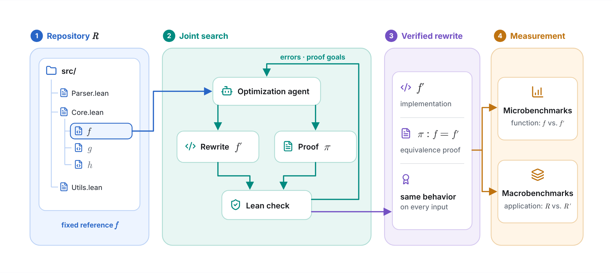
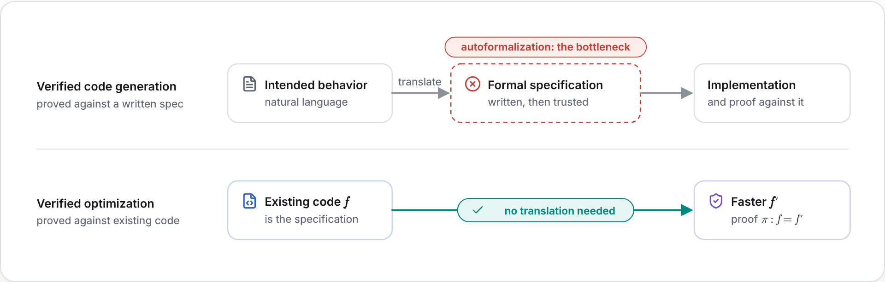
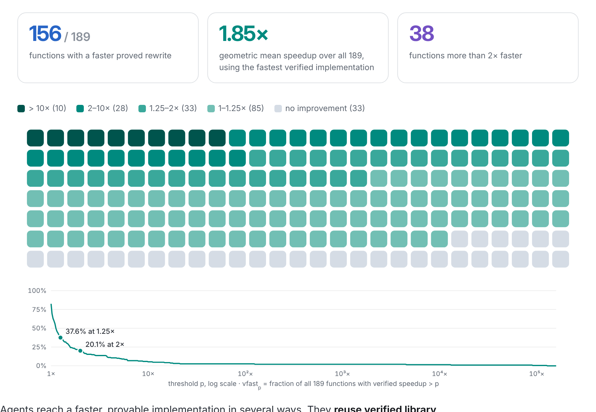
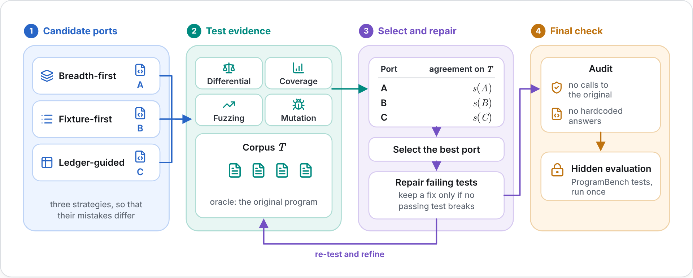
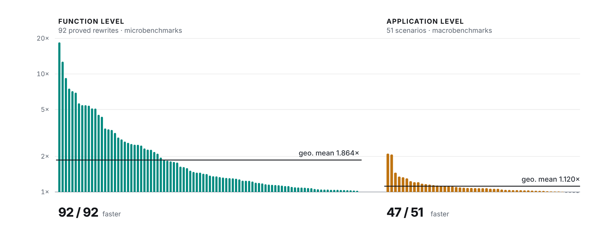

<style>
.blog-post img.content-image { max-width: 100%; }
.blog-post video { display: block; width: 100%; margin: 2rem auto; border-radius: 8px; box-shadow: 0 4px 6px rgba(0, 0, 0, 0.1); }
</style>



# Agentic Verified Optimization of Real-World Software

<div class="author-info">
<strong>
    Zhe Ye, Udaya Ghai, Zhizhen Qin, Dawn Song, Soonho Kong
</strong>
<br>
UC Berkeley; Amazon Web Services
<br>
November, 2026  |  Approximately 4-minute read  |  <a href="https://arxiv.org/abs/2610.30188" target="_blank">Paper</a>  |  <a href="https://aqueduct.verina.io" target="_blank">Project website</a>
</div>

*Coding agents can make programs faster. Can they also prove that the faster program returns the same result as the original on every input?*

We ask coding agents to make an existing function *f* faster and to prove, in the Lean proof assistant, that the faster version *f′* returns the same result as *f* on every input. Formal verification usually needs a specification, a formal statement of what a program should do, and such statements are hard to write correctly. Here *f* is the specification, so nobody has to write one. Agents produce proved speedups for 156 of the 189 small programs in the Verina benchmark. On 17 C, C++, Go, and Rust applications that our framework Aqueduct migrates into Lean, 92 proved rewrites make 47 of 51 application scenarios faster.

<video controls muted playsinline preload="metadata" poster="video-poster.png">
  <source src="video.mp4" type="video/mp4">
</video>

## Speedups need a check that covers every input

Coding agents now rewrite programs for speed, generate GPU kernels, and synthesize systems specialized to a workload, and they check that the faster program still behaves correctly by running tests. Tests can show that a program is wrong, but not that it is right. The difference matters when the tests also decide the agent's reward, because the agent can then pass the tests without preserving the behavior. One [report](https://arxiv.org/abs/2605.24096) describes an apparent 6× improvement that came from regenerating test values instead of storing them, and an [audit](https://arxiv.org/abs/2608.12700) found correctness failures in 39.5% of the GPU kernels that an optimization harness had accepted.

A proof of equivalence covers every input. Verified compilers and superoptimizers already optimize with this guarantee, but only through passes proved correct in advance or over short instruction sequences, so they find only what those transformations can express. Agents are not limited to a fixed set of transformations and can propose new algorithms and data representations. With a proof as the check, an agent can change both freely, and the correctness requirement stays the same.

## The existing code is the specification

Proving capability has advanced quickly, and provers trained with reinforcement learning now reach olympiad level. A proof, however, establishes only the statement it proves, and translating intended behavior into a correct formal statement, or autoformalization, is now the bottleneck. Specifications for programs are hard to write correctly, and even curated ones contain errors, as the audit in [Vero](/blog/vero) showed. Verified optimization does not need a new statement, because the existing implementation is the specification and the theorem *f* = *f′* is fixed before the agent starts.



*Figure 1. Where the specification comes from. Verified code generation proves an implementation against a specification translated from intended behavior, while verified optimization proves f′ against the existing code f.*

We formulate the task in Lean 4, which is both a proof assistant and a general-purpose programming language, so the same definitions run as compiled programs and appear in proofs. The agent revises the rewrite *f′* and the proof using Lean's errors and proof goals, and Lean's kernel checks the proof against the unchanged *f*. A speedup therefore counts only with a proof of equality to the original, and neither weak tests nor a written specification that omits part of the intended behavior can be exploited. This makes the task resistant to reward hacking. Because correctness is fixed and speedup is a continuous measure rather than a pass rate, the task also does not saturate as agents improve, and every function in an existing codebase is a new instance with its specification already in place.

## Faster algorithms with proofs

On the 189 programs in [Verina](https://arxiv.org/abs/2505.23135), agents produce faster proved rewrites for 156, with a 1.85× geometric mean speedup. For the longest increasing subsequence, the agent replaced an implementation that explores 2ⁿ branches with dynamic programming, proved the two equal, and made the function 4,468× faster. The largest speedups, up to 128,292×, replace iterated sums with closed-form polynomials.



*Figure 2. Best verified speedup for each Verina function, ordered from fastest to slowest, with gray squares for functions with no improvement. The curve shows the fraction of all 189 functions whose verified speedup exceeds each threshold.*

## Real applications in native Lean

Lean is a general-purpose programming language, but few real-world applications are written in it, and repository-level optimization needs such applications with their callers and workloads. We built Aqueduct, an agentic framework that migrates C, C++, Go, and Rust programs into native Lean and checks each port against the original program through differential testing. On 40 repositories from [ProgramBench](https://arxiv.org/abs/2605.03546), Aqueduct's ports pass 87.7% of the hidden tests that the original programs pass, compared with 68.2% for a single migration agent. The ports include the Ninja build system, the pigz compressor, the Doxygen documentation generator, and a port of 7zip from about 253,000 source lines.



*Figure 3. Aqueduct. Three migration strategies produce candidate ports, test-design agents build a shared test corpus against the original program, and a controller selects and repairs the best port before evaluating it once on hidden tests.*

## Faster functions, smaller end-to-end gains

On 17 migrated applications, the agent chooses which functions to rewrite. All 92 proved rewrites are faster on their microbenchmarks, with a 1.86× geometric mean, and together they make 47 of 51 application scenarios faster. The application-level gain is only 1.12×, because a function speedup counts only for the share of time spent in that function, so choosing which functions to optimize is an important problem. Widely used software also still has room to get faster. In 15 of the 92 functions, the optimized Lean code already runs faster than the matching operation in the original native program.



*Figure 4. Speedups of the optimized Lean ports over the migrated ports on one log scale, for each proved rewrite on its microbenchmark and for each application scenario with all rewrites integrated.*

## What comes next

The obligation *f* = *f′* does not depend on the level at which *f′* is written. A rewrite could therefore target explicit memory layouts or vector instructions, with a proof that the compiled code implements *f*. Modeling file and network I/O behind an interface of primitive operations would also bring the I/O paths of applications into scope.

## Learn more

The [project website](https://aqueduct.verina.io) has more details and examples, and the [paper](https://arxiv.org/abs/2610.30188) has the full method and results.

[Project website](https://aqueduct.verina.io)  |  [Paper](https://arxiv.org/abs/2610.30188)

```bibtex
@article{ye2026agentic,
  title={Agentic Verified Optimization of Real-World Software},
  author={Ye, Zhe and Ghai, Udaya and Qin, Zhizhen and Song, Dawn and Kong, Soonho},
  journal={arXiv preprint arXiv:2610.30188},
  year={2026}
}
```
